# KUKA KR 6 R900 sixx kinematics in Python

Forward kinematics, closed-form inverse kinematics, the 6x6 geometric
Jacobian, singularity checks, and joint- and task-space trajectories for the
KUKA KR 6 R900 sixx, a 6-axis industrial arm. This began as my final project
for Intro to Robotics (ENGR 431) at Fort Lewis College; I later cleaned it
up into a small Python package with tests. It is analysis and simulation
only; it was not run on a physical KUKA arm.

[](https://github.com/Janga786/kuka-kr6-kinematics/actions/workflows/ci.yml)
[](LICENSE)

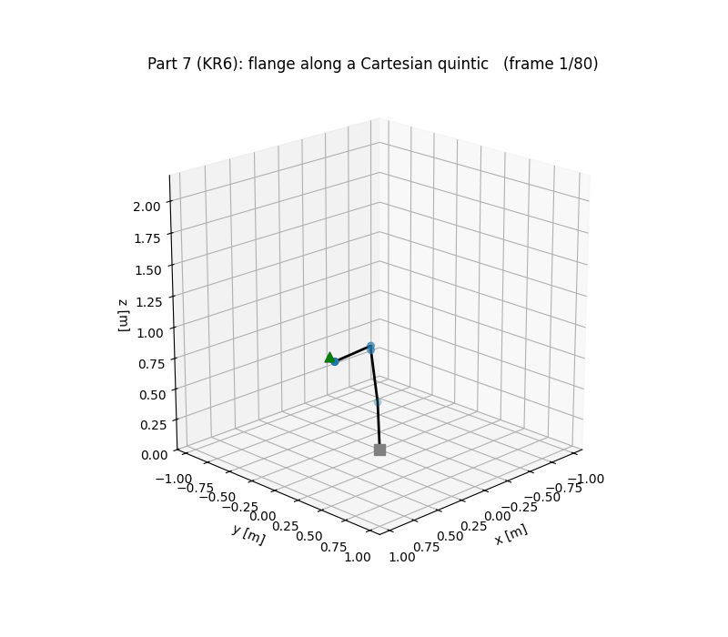
&nbsp;
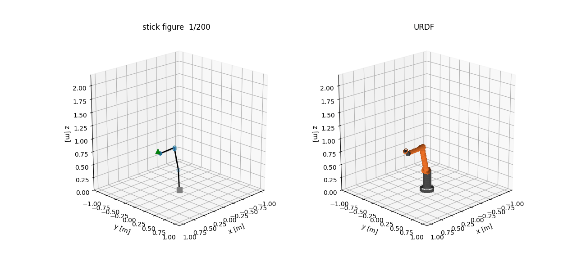

<sub><i>Left:</i> a straight-line task-space path executed with the closed-form position IK and Jacobian-based velocity IK.
<i>Right:</i> the same motion through the analytic DH chain and through the generated URDF reloaded by <code>urchin</code>.</sub>

## What I derived and implemented by hand

All of the kinematics are written directly in NumPy from the robot's geometry
and data sheet. No robotics toolbox (for example `roboticstoolbox` or MoveIt)
computes any of it.

- **DH model and forward kinematics** (`kr6_kinematics/dh.py`): the
  standard-DH table for the KR 6 and the 4x4 link transforms, composed into
  the flange pose.
- **Geometric Jacobian** (`jacobian.py`): each column built from the joint
  axis and position, `[z_i x (p_e - p_i); z_i]`, plus Yoshikawa
  manipulability and a singularity check.
- **Closed-form inverse kinematics** (`ik.py`): Pieper decoupling at the
  spherical wrist, planar geometry for joints 1-3 and a ZYZ Euler
  decomposition for joints 4-6, with elbow-up/down selection. Velocity IK
  solves `J q_dot = twist`.
- **Trajectories** (`trajectories.py`): quintic time scaling (with zero
  boundary velocity and acceleration this is the minimum-jerk profile) and
  LSPB, plus a straight-line task-space path.
- **URDF generator** (`urdf_builder.py`): writes a URDF whose link frames
  match the DH frames, used as an independent check.

Libraries used: `spatialmath`'s `SE3` class only as a container for 4x4
transforms, `urchin` only to reload the generated URDF for cross-checking, and
`matplotlib` for figures.

## How it is checked

39 pytest tests (all pass in a few seconds; CI runs them on Python
3.10-3.12, Ubuntu and macOS). The main checks:

| Check | Result | Where |
| :--- | :--- | :--- |
| Wrist-centre reach at q = 0 vs. KUKA data sheet (0.901 m) | within 5 mm | `tests/test_dh.py` |
| Analytic vs. central finite-difference Jacobian | under 1e-5 in the test (30 configs); about 3e-10 max over 50 configs in the driver script | `tests/test_jacobian.py`, `scripts/jacobian_singularities.py` |
| FK -> IK -> FK round trip, shoulder-front branch | under 1 µm in the test (100 random configs, at least 80% must solve); 200 of 200 solved in the driver script, max rotation error about 2e-15 | `tests/test_ik.py`, `scripts/inverse_kinematics.py` |
| Velocity IK reproduces the requested twist | to 1e-12 | `tests/test_ik.py` |
| Generated URDF (via `urchin`) vs. analytic DH at the ready pose | test tolerance 50 µm; measured about 2 µm | `tests/test_urdf.py`, `scripts/urdf_demo.py` |
| Manipulability near the wrist singularity (q5 -> 0) | drops below 5% of its ready-pose value | `tests/test_jacobian.py` |
| Quintic and LSPB boundary conditions | quintic to 1e-10; LSPB endpoint and cruise-speed checks | `tests/test_trajectories.py` |

Known limits are listed under [Limitations](#limitations).

```bash
python -m venv .venv && source .venv/bin/activate
make dev     # pip install -e ".[dev]"
make test    # 39 tests
make all     # regenerate every figure and animation
```

## Gallery

<table>
<tr>
<td align="center" width="33%">
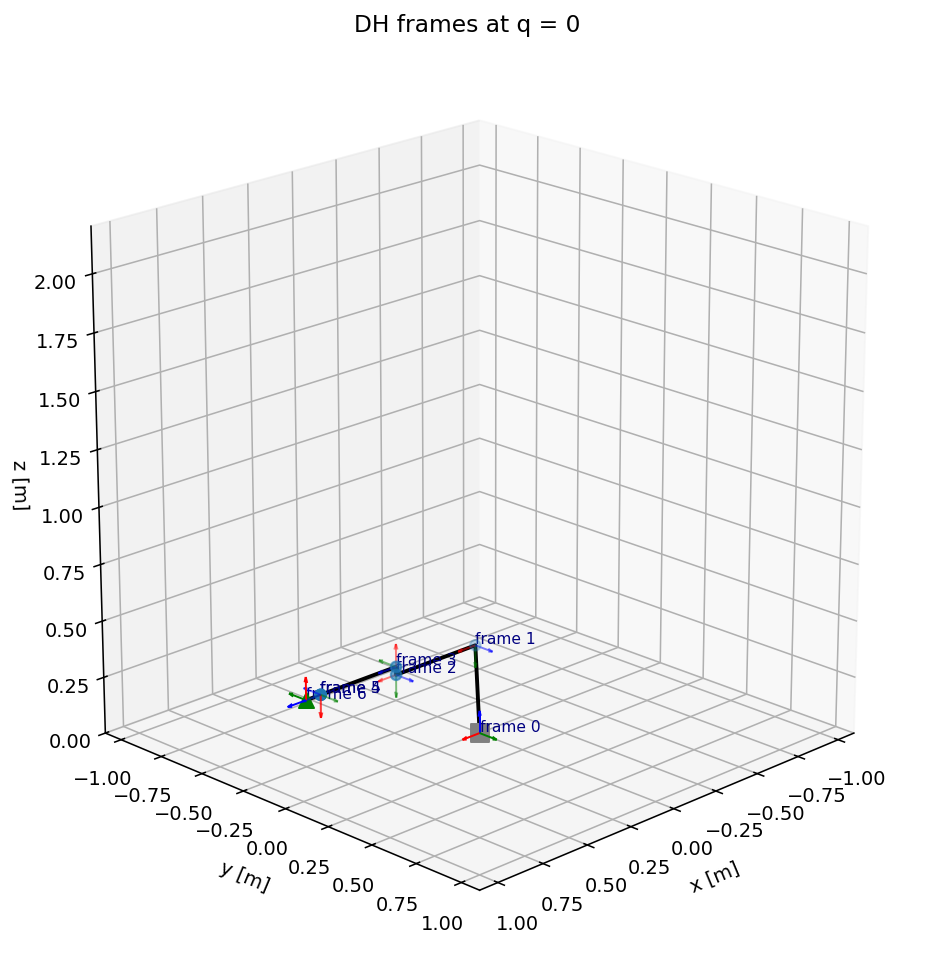<br/>
<sub><b>DH frames.</b> The seven DH frames at q = 0, with each frame's RGB triad in place. Used as the geometric ground truth for the rest of the project.</sub>
</td>
<td align="center" width="33%">
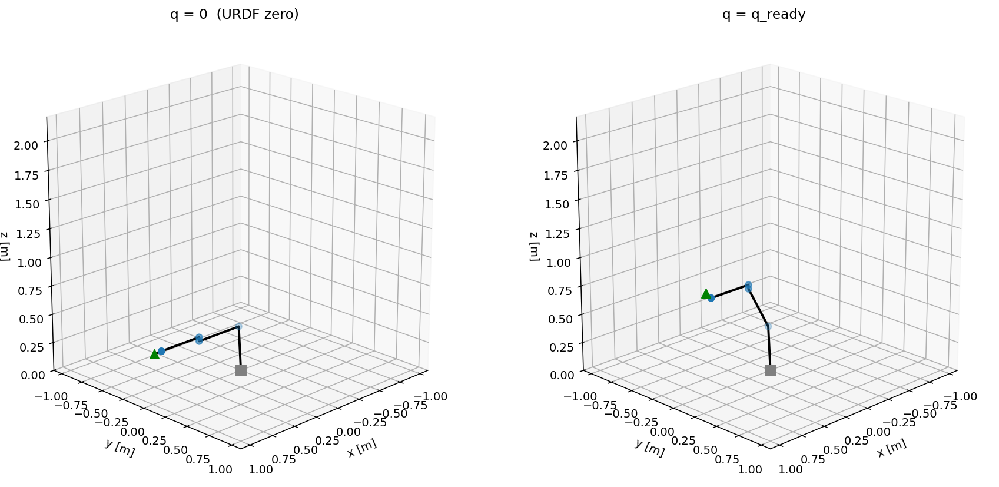<br/>
<sub><b>Forward kinematics.</b> Composite forward kinematics evaluated at the URDF zero pose and at the canonical "ready" pose, plotted as stick figures.</sub>
</td>
<td align="center" width="33%">
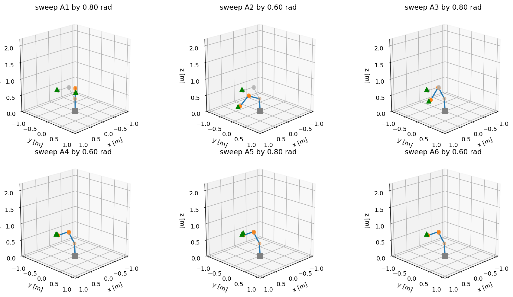<br/>
<sub><b>Joint isolation.</b> Six-up panel: each subplot shows the ready pose (grey) ghosted against the result of perturbing one joint by 0.6–0.8 rad.</sub>
</td>
</tr>
<tr>
<td align="center">
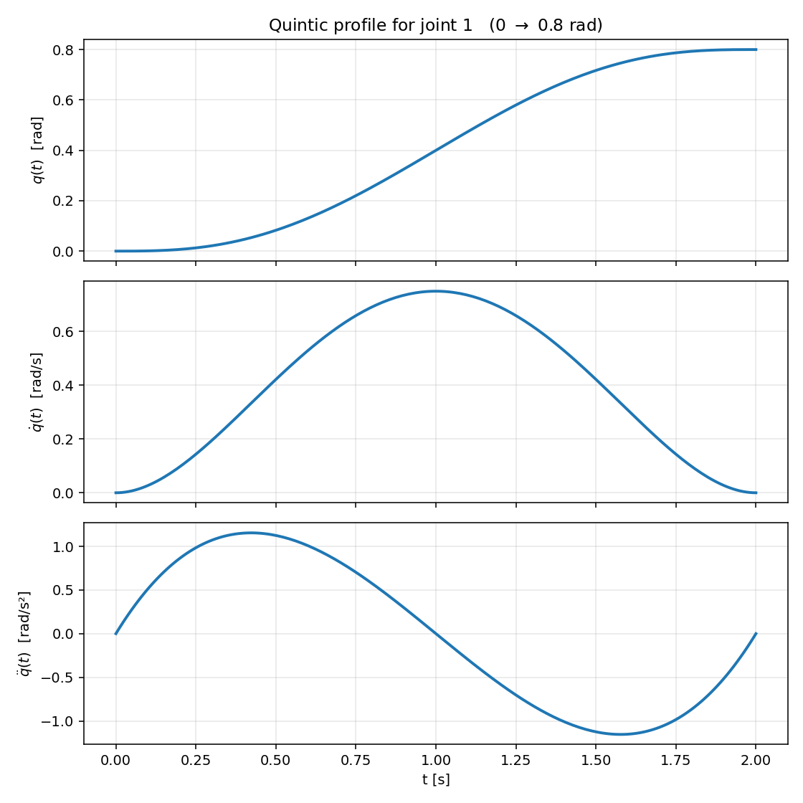<br/>
<sub><b>Quintic profile.</b> Quintic time-scaling of joint 1 from 0 → 0.8 rad in 2 s. Position, velocity and acceleration are all C² and zero at the boundaries.</sub>
</td>
<td align="center">
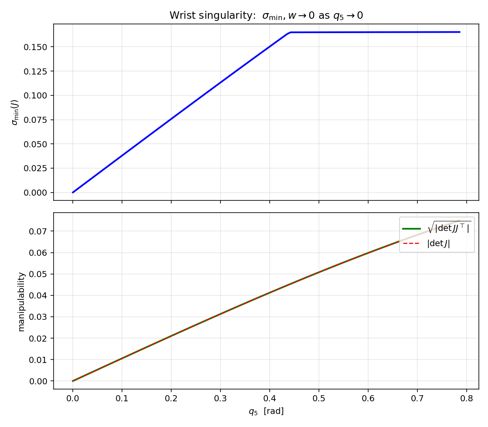<br/>
<sub><b>Wrist singularity.</b> Sweeping q₅ from the ready value down to zero, both σ\_min(J) and the manipulability index w = √det(JJᵀ) collapse — the wrist singularity in numbers.</sub>
</td>
<td align="center">
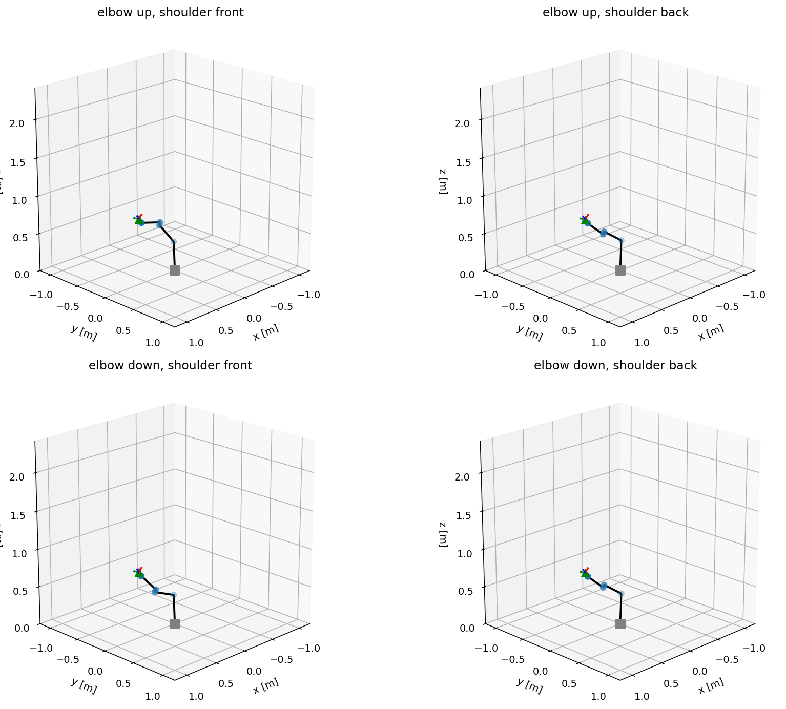<br/>
<sub><b>IK branches.</b> The four position-IK branches (elbow up/down × shoulder front/back) for one flange target. Only the two shoulder-front branches are verified to reach the target; see Limitations.</sub>
</td>
</tr>
<tr>
<td align="center">
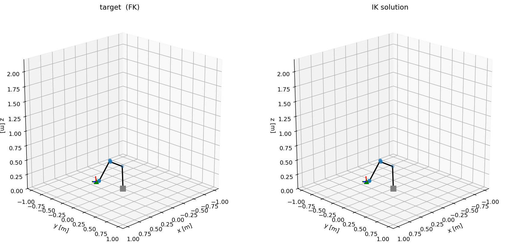<br/>
<sub><b>IK round-trip.</b> A visual round-trip: target pose (left) and the configuration recovered by the closed-form IK (right). Position error below 1 µm.</sub>
</td>
<td align="center">
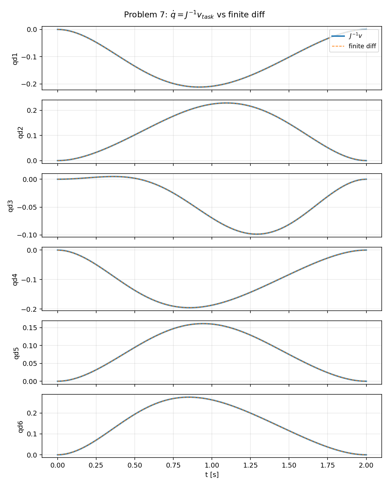<br/>
<sub><b>Velocity IK check.</b> Joint velocities reconstructed from the inverse velocity equation q̇ = J⁻¹·v\_task (solid) overlaid with finite differences of the joint trajectory (dashed). They agree.</sub>
</td>
<td align="center">
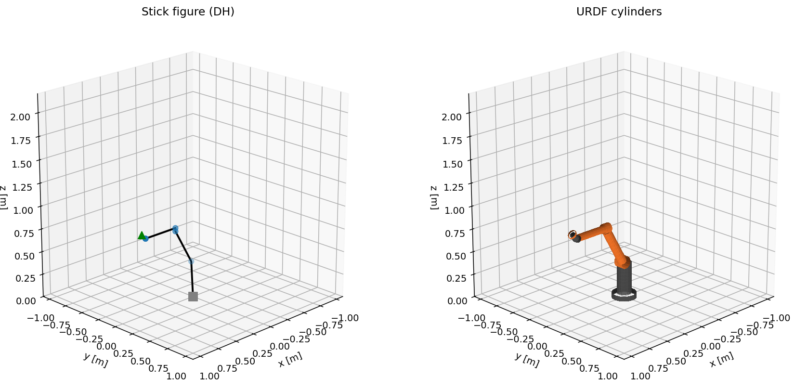<br/>
<sub><b>DH vs. URDF.</b> Stick figure (analytic DH) vs. cylinders (auto-generated URDF reloaded by <code>urchin</code>) at the ready pose. The frames agree to within the 50 µm test tolerance.</sub>
</td>
</tr>
</table>

<details>
<summary><b>More animations</b></summary>

<table>
<tr>
<td align="center">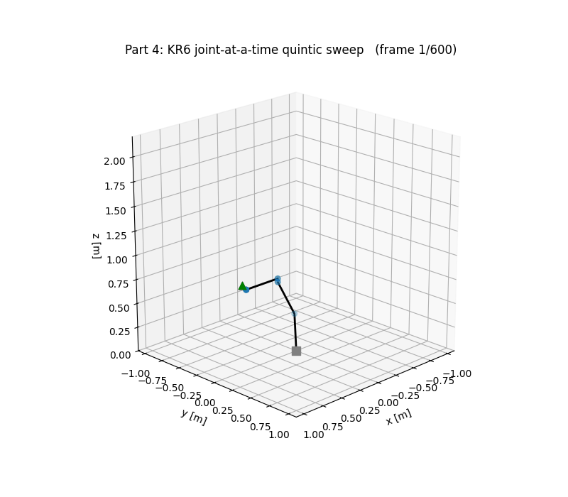<br/>
<sub><b>Joint sweep.</b> An out-and-back quintic sweep on each axis in turn, with the flange path traced in orange.</sub></td>
<td align="center">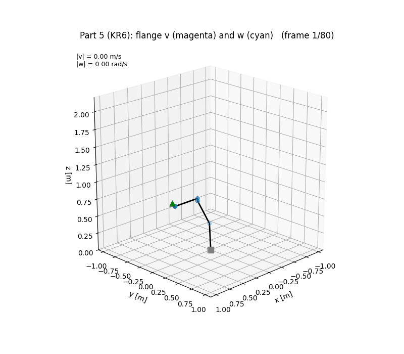<br/>
<sub><b>Velocity arrows.</b> Linear- (magenta) and angular- (cyan) velocity arrows of the flange computed from <code>J(q) q̇</code>.</sub></td>
</tr>
</table>

</details>

## Mathematical foundations

### 1. Standard-DH link transform

Every revolute link contributes a homogeneous transform of the form

$$
T_{i-1}^{\,i}(\theta_i) \;=\; R_z(\theta_i)\,T_z(d_i)\,T_x(a_i)\,R_x(\alpha_i)
\;=\;
\begin{bmatrix}
c\theta & -s\theta\,c\alpha &  s\theta\,s\alpha & a\,c\theta \\
s\theta &  c\theta\,c\alpha & -c\theta\,s\alpha & a\,s\theta \\
0       & s\alpha           & c\alpha           & d \\
0       & 0                 & 0                 & 1
\end{bmatrix}.
$$

Composing six of these yields the flange pose $T_0^6(q) = \prod_{i=1}^6 T_{i-1}^{\,i}(\theta_i + \theta_{0,i})$.

### 2. Geometric Jacobian

For a serial chain of revolute joints, the *i*-th column of the 6 × 6 base-frame Jacobian is

$$
J_i(q) \;=\; \begin{bmatrix} \hat z_i \times (p_e - p_i) \\ \hat z_i \end{bmatrix},
\qquad
\begin{bmatrix} v_e \\ \omega_e \end{bmatrix} \;=\; J(q)\,\dot q,
$$

with $\hat z_i$ the joint axis and $p_i, p_e$ the joint and end-effector positions in the base frame. Because the manipulator is non-redundant, inverse velocity kinematics reduces to `np.linalg.solve(J, twist)`.

### 3. Pieper's spherical-wrist decoupling

The KR 6's wrist axes (A4, A5, A6) intersect at a common point. For any target pose $(R_d, p_d)$, the wrist centre is

$$
p_{\mathrm{wc}} \;=\; p_d - d_6\,R_d\,\hat z,
$$

so $q_1, q_2, q_3$ are determined by the planar 2-link geometry of the upper arm and the effective forearm, and $q_4, q_5, q_6$ are recovered by ZYZ-Euler decomposition of $R_3^6 = (R_0^3)^{\!\top} R_d$. This produces a **closed-form** IK with ≤ 8 solution branches; the implementation returns one, selected by `elbow_up` and `shoulder_front`.

### 4. Quintic time-scaling

A 5th-order polynomial $q(t) = \sum_{k=0}^{5} a_k t^k$ has six coefficients — exactly enough to satisfy boundary $q, \dot q, \ddot q$ on both ends. The coefficients are the unique solution of a 6 × 6 linear system. In the code (`kr6_kinematics.trajectories.quintic`) this is solved directly with `np.linalg.solve`. With zero velocity and acceleration at both ends, the result is the minimum-jerk profile.

## Usage

Install with `make dev` (or `pip install -e ".[dev]"`). Dependencies: `numpy`, `matplotlib`, `spatialmath-python`, `urchin`, `pillow`.

```python
import numpy as np
from kr6_kinematics import (
    Q_READY, kr6_fk, jacobian, ik_position, manipulability,
)

# 1. forward kinematics
T = kr6_fk(Q_READY)
print("flange position:", np.round(T.t, 4))

# 2. round-trip the closed-form IK
q_back = ik_position(T, elbow_up=True, shoulder_front=True)
assert np.allclose(kr6_fk(q_back).A, T.A, atol=1e-10)

# 3. inspect the Jacobian and manipulability at q_ready
J = jacobian(Q_READY)
print("σ(J):", np.round(np.linalg.svd(J, compute_uv=False), 4))
print("w   :", manipulability(Q_READY))
```

## Reproducing every figure & animation

```bash
make all
```

Or run the drivers individually:

| Driver | Outputs |
| :--- | :--- |
| `python scripts/robot_spec.py` | text-only manufacturer spec dump |
| `python scripts/dh_frames.py` | `figures/dh_frames.png` |
| `python scripts/forward_kinematics.py` | `figures/forward_kinematics_configs.png` |
| `python scripts/joint_trajectories.py` | `quintic_profile.png`, `joint_isolation_panel.png`, `animations/joint_sweep.gif` |
| `python scripts/jacobian_singularities.py` | `wrist_singularity_sweep.png`, `animations/velocity_arrows.gif` |
| `python scripts/inverse_kinematics.py` | `ik_round_trip.png`, `ik_branches.png` |
| `python scripts/task_space_trajectory.py` | `task_space_*.png`, `task_space_Q.npy`, `animations/task_space_motion.gif` |
| `python scripts/urdf_demo.py` | `urdf/kr6_sdh.urdf`, `urdf_vs_stick.png`, `animations/urdf_vs_stick.gif` |

The verification scripts use fixed random seeds, so their printed numbers repeat from run to run.

## Robot specifications

| Parameter | Value | Source |
| :--- | :--- | :--- |
| Manufacturer / model | KUKA Roboter GmbH · KR 6 R900 sixx (KR AGILUS family) | KUKA OpInst (2015) |
| Number of axes | 6 (all revolute) | KUKA OpInst |
| Reach | 0.901 m to wrist centre, 0.981 m to flange | KUKA OpInst |
| Payload | 6 kg max (3 kg rated for optimal cycle time) | KUKA OpInst |
| Repeatability | ± 0.03 mm (ISO 9283) | KUKA OpInst |
| Working envelope | 2.85 m³ | KUKA OpInst |
| Joint limits q\_min (deg) | [−170, −190, −120, −185, −120, −350] | KUKA OpInst |
| Joint limits q\_max (deg) | [+170, +45, +156, +185, +120, +350] | KUKA OpInst |
| Joint speeds q̇\_max (rad/s) | [6.28, 5.24, 6.28, 6.65, 6.77, 10.73] | KUKA OpInst |
| DH parameters | see `kr6_kinematics/dh.py · KR6_SDH` | this repo |

## API reference

The package exports 25 public names. See the module docstrings
(`pydoc kr6_kinematics`) and the tests for usage.

| Group | Names |
| :--- | :--- |
| DH parameters & FK | `KR6_SDH`, `Q_ZERO`, `Q_READY`, `JOINT_NAMES`, `dh_link`, `dh_link_SE3`, `kr6_frames`, `kr6_fk` |
| Joint limits | `Q_MIN`, `Q_MAX`, `QD_MAX`, `clip_to_limits`, `in_limits` |
| Velocity kinematics | `jacobian`, `manipulability`, `is_singular` |
| Inverse kinematics | `ik_position`, `ik_velocity` |
| Trajectories | `quintic`, `quintic_vec`, `lspb` |
| Visualisation | `setup_3d_axes`, `draw_frame`, `draw_stick_figure`, `animate_joint_trajectory` |

## Testing

```bash
make test                                       # 39 tests
python -m pytest tests/test_jacobian.py -v      # one module, verbose
python -m pytest tests/ --cov=kr6_kinematics    # with coverage (needs pytest-cov)
```

The test-suite covers:

- DH transform shape, orthonormality and base-frame conventions
- FK numerical sanity (manufacturer reach, smoothness under perturbation)
- Joint-limit clipping and predicate
- Analytic vs. finite-difference Jacobian agreement
- Manipulability collapse near the wrist singularity
- IK round-trip (one fixed config + 100 random, shoulder-front branch)
- IK velocity vs. Jacobian inverse, and forward consistency `J · q̇ = ξ`
- Quintic / quintic\_vec / LSPB boundary conditions and derivative consistency
- Generated-URDF parseability
- `urchin` URDF FK vs. analytic DH FK
- The committed URDF stays in sync with `build_urdf_string()`

## Repository layout

```
kuka-kr6-kinematics/
├── kr6_kinematics/             # the library (importable Python package)
│   ├── __init__.py             # public API
│   ├── dh.py                   # DH table, FK, joint-limit utilities
│   ├── jacobian.py             # geometric Jacobian + singularity diagnostics
│   ├── ik.py                   # closed-form IK (Pieper) + velocity IK
│   ├── trajectories.py         # quintic & LSPB trajectory primitives
│   ├── viz.py                  # 3-D stick-figure / animation helpers
│   └── urdf_builder.py         # programmatic URDF generation
│
├── scripts/                    # topical driver scripts
│   ├── robot_spec.py           # print manufacturer specs + reach sanity check
│   ├── dh_frames.py            # DH table + 3-D frame visualisation
│   ├── forward_kinematics.py   # FK at canonical poses
│   ├── joint_trajectories.py   # quintic profiles + per-joint sweep animation
│   ├── jacobian_singularities.py   # J(q), FD verification, wrist singularity
│   ├── inverse_kinematics.py   # closed-form IK + branch enumeration
│   ├── task_space_trajectory.py    # straight-line task-space path with IK
│   ├── urdf_demo.py            # generate URDF and compare with DH
│   └── run_all.py              # regenerate every figure & animation
│
├── tests/                      # 39 pytest tests
│   ├── test_dh.py
│   ├── test_jacobian.py
│   ├── test_ik.py
│   ├── test_trajectories.py
│   └── test_urdf.py
│
├── figures/                    # static PNGs emitted by the drivers
├── animations/                 # animated GIFs
├── urdf/kr6_sdh.urdf           # auto-generated URDF
│
├── pyproject.toml              # PEP 517/518 build + tooling configuration
├── requirements.txt            # runtime dependencies
├── requirements-dev.txt        # + pytest, ruff, mypy
├── Makefile                    # `make install`, `make test`, `make all`
├── .github/workflows/ci.yml    # CI: tests on Ubuntu/macOS, Python 3.10-3.12
├── CITATION.cff
├── CONTRIBUTING.md
├── LICENSE                     # MIT
└── README.md
```

## Limitations

- The `shoulder_front=False` IK branch returns a kinematically valid but
  not necessarily target-reaching configuration; it's preserved for the
  branch-panel visualisation but should not be used for closed-loop
  control. A clean fix requires a sign-aware ZYZ decomposition.
- The auto-generated URDF uses cylinder primitives sized to look like
  the real arm, but it carries placeholder mass / inertia. For
  contact-rich simulation in MuJoCo / PyBullet, replace with the
  ROS-Industrial mesh package.
- No collision-aware path planning is included; the trajectories assume
  a free workspace. Dropping in `python-fcl` would be a straightforward
  extension.
- Only single-arm kinematics are modelled — base motion, end-effector
  tooling and the full controller dynamics are out of scope.
- Not tested on a physical KUKA arm; all results are numerical checks
  and visualizations.

## References

1. M. W. Spong, S. Hutchinson, and M. Vidyasagar. *Robot Modeling and Control*. Wiley, 2nd ed., 2020.
2. B. Siciliano, L. Sciavicco, L. Villani, and G. Oriolo. *Robotics: Modelling, Planning and Control*. Springer, 2010.
3. D. L. Pieper. "The Kinematics of Manipulators Under Computer Control." Stanford AIM-72, 1968.
4. T. Yoshikawa. "Manipulability of robotic mechanisms." *IJRR* 4(2), 1985, pp. 3–9.
5. KUKA Roboter GmbH. *KR 6 R900 sixx — Operating Instructions*, 2015.
6. ROS-Industrial. `kuka_experimental/kuka_kr6_support` — KR 6 URDFs and meshes. <https://github.com/ros-industrial/kuka_experimental>
7. P. Corke. *Robotics, Vision and Control* (Python edition). Springer, 2023. (`spatialmath-python`)

## License

MIT. See [LICENSE](LICENSE). A citation file is in [CITATION.cff](CITATION.cff).
